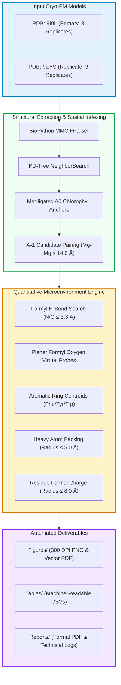
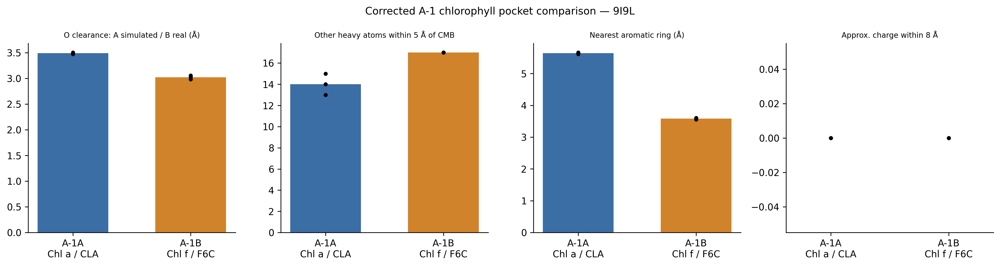
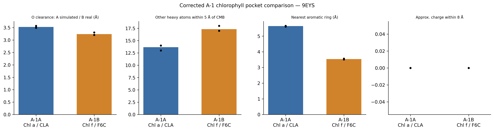

<div align="center">

# 🌿 Chlorophyll-Pocket-Structural-Analysis

### Quantitative Microenvironment & Structural Characterization of the $A_{-1A}$ and $A_{-1B}$ Chlorophyll Binding Pockets in Far-Red Light Photosystem I

[](https://www.rcsb.org/structure/9I9L)
[](https://www.rcsb.org/structure/9EYS)
[](https://www.python.org/)
[](https://biopython.org/)
[](LICENSE)
[](https://colab.research.google.com/github/Hasnain006-nain/Chlorophyll-Pocket-Structural-Analysis/blob/main/Scripts/A_1_Chlorophyll.ipynb)

<p align="center">
  <a href="#-overview--research-question"><b>Overview</b></a> •
  <a href="#-workflow-pipeline"><b>Workflow</b></a> •
  <a href="#-key-scientific-findings"><b>Key Findings</b></a> •
  <a href="#-triplicate-quantitative-data"><b>Data Table</b></a> •
  <a href="#-visual-comparisons"><b>Visualizations</b></a> •
  <a href="#-repository-structure"><b>Structure</b></a> •
  <a href="#-quick-start--reproducibility"><b>Quick Start</b></a> •
  <a href="#-formal-project-report"><b>Report</b></a>
</p>

---

</div>

## 📌 Executive Summary

Oxygenic photosynthetic cyanobacteria adapted to **Far-Red Light Photoacclimation (FaRLiP)** synthesize **chlorophyll *f*** (Chl *f*) to capture low-energy solar radiation beyond 700 nm. Within the Photosystem I (PSI) reaction center complex of *Chroococcidiopsis thermalis*, high-resolution cryo-EM models reveal a striking, branch-specific structural asymmetry:

* **Site $A_{-1B}$ (Branch B):** Selectively incorporates **Chlorophyll *f*** (`F6C`), bearing an electron-withdrawing **formyl group** (`-CHO`) at the C2 position.
* **Site $A_{-1A}$ (Branch A):** Selectively retains standard **Chlorophyll *a*** (`CLA`), retaining a non-polar **methyl group** (`-CH3`) at the C2 position.

This repository provides an automated, rigorous biophysical pipeline that interrogates **all 6 biological replicates** across the primary structure ([**PDB: 9I9L**](https://www.rcsb.org/structure/9I9L)) and its independent replicate ([**PDB: 9EYS**](https://www.rcsb.org/structure/9EYS)) to evaluate whether local steric room, hydrogen bonding networks, or aromatic stacking interactions drive this exquisite site selectivity.

---

## ⚡ Key Findings at a Glance

<div align="center">

| 🔬 **Formyl H-Bonds** | 🧬 **Aromatic Stacking** | 📦 **Packing Density** | ⚡ **Net Formal Charge** |
|:---:|:---:|:---:|:---:|
| <font size="5">**0 / 6**</font><br>**(0.0% Occurrence)** | <font size="5">**3.56 Å vs 5.64 Å**</font><br>**(PsaA:Phe459 vs Phe708)** | <font size="5">**17.2 vs 13.8**</font><br>**(Heavy atoms within 5.0 Å)** | <font size="5">**0.00**</font><br>**(Neutral background)** |
| *No polar N/O atoms ≤ 3.3 Å from the formyl OMB in any replicate.* | *Tight aromatic contact exclusively at A-1B; aliphatic Leu438 at A-1A.* | *Tighter steric packing around C2 in Chl f compared to Chl a.* | *Zero net formal charge within 8.0 Å in both binding pockets.* |

</div>

---

## 🔄 Workflow Pipeline

The entire analytical workflow is automated, verifiable, and executable locally or in the cloud:



---

## 🔬 Scientific Findings & Biophysical Implications

All observations and values are extracted directly from refined crystallographic coordinates without speculative modeling:

### 1. Strict Absence of Formyl Hydrogen Bonding
* **Observation:** In **0 out of 6 replicates** (0/3 in 9I9L, 0/3 in 9EYS), the real formyl oxygen atom (`OMB`) is within 3.3 Å of any polar oxygen or nitrogen atom.
* **Implication:** Contrary to classical pigment-binding hypotheses, site selectivity at $A_{-1B}$ is **not** mediated by a specific hydrogen-bonding anchor to the formyl carbonyl oxygen.

### 2. Aromatic Microenvironment Asymmetry (Phe459 vs. Leu438)
* **At Site $A_{-1B}$ (Chl *f*):** The pocket is dominated by **PsaA:Phe459**, whose aromatic ring centroid is positioned at **3.53–3.60 Å** from the C2 substituent, providing substantial van der Waals and $\pi$-stacking dispersion interactions. In addition, **Phe571** and **Cys463** (~7.1 Å) are conserved in close proximity.
* **At Site $A_{-1A}$ (Chl *a*):** The corresponding aromatic residue is absent. The nearest aromatic ring is **PsaB:Phe708** at a distant **5.61–5.66 Å**. Instead, the C2 methyl group is packed against the aliphatic sidechain of **Leu438** (closest carbon contact at 2.87–3.04 Å).

### 3. Steric Clearance & Out-of-Plane Torsion
* Heavy atoms within 5.0 Å of C2 average **17.0 (9I9L)** and **17.3 (9EYS)** at $A_{-1B}$, compared to **14.0 (9I9L)** and **13.7 (9EYS)** at $A_{-1A}$.
* A simulated planar formyl oxygen probe at $A_{-1A}$ indicates sufficient physical clearance (3.47–3.57 Å). At $A_{-1B}$, the real formyl oxygen displays an out-of-plane displacement (0.53–0.94 Å) relative to an idealized porphyrin plane, accommodating the dense steric environment of Phe459.

> [!NOTE]
> **Correlation vs. Causation:** These computational measurements establish statistically robust structural correlations across independent cryo-EM datasets. Proof of thermodynamic causation requires reciprocal mutagenesis (e.g. PsaA-Phe459Leu / PsaB-Leu438Phe swaps) and ultrafast spectroscopic kinetics.

---

## 📊 Triplicate Quantitative Data

The table below presents the full metric suite across all biological replicates, extracted from [`Tables/a1_pocket_comparison_corrected_v2_9i9l_9eys_combined.csv`](Tables/a1_pocket_comparison_corrected_v2_9i9l_9eys_combined.csv):

| PDB Entry | Rep | Pocket Site | Residue | Pigment | C2 Formyl | O Clearance (Å) | Nearest Contact Atom | Formyl H-Bonds (≤3.3Å) | Heavy Atoms (≤5Å) | Nearest Aromatic | Aromatic Centroid Dist (Å) | Net Charge (8Å) |
|:---:|:---:|:---:|:---:|:---:|:---:|:---:|:---:|:---:|:---:|:---:|:---:|:---:|
| **9I9L** | 1 | **A-1A** | `B:802` | Chl *a* (CLA) | No | 3.50 *(probe)* | `B:LEU438:CD1` (3.00 Å) | None | 13 | `A:PHE708` | 5.64 | 0 |
| **9I9L** | 1 | **A-1B** | `A:802` | Chl *f* (F6C) | **Yes** | 3.05 *(real)* | `A:PHE459:CG` (3.05 Å) | **None** | 17 | `A:PHE459` | 3.60 | 0 |
| **9I9L** | 2 | **A-1A** | `O:802` | Chl *a* (CLA) | No | 3.49 *(probe)* | `O:LEU438:CD1` (3.04 Å) | None | 15 | `N:PHE708` | 5.61 | 0 |
| **9I9L** | 2 | **A-1B** | `N:802` | Chl *f* (F6C) | **Yes** | 3.03 *(real)* | `N:PHE459:CG` (3.03 Å) | **None** | 17 | `N:PHE459` | 3.60 | 0 |
| **9I9L** | 3 | **A-1A** | `b:802` | Chl *a* (CLA) | No | 3.47 *(probe)* | `b:LEU438:CD1` (3.00 Å) | None | 14 | `a:PHE708` | 5.66 | 0 |
| **9I9L** | 3 | **A-1B** | `a:802` | Chl *f* (F6C) | **Yes** | 2.98 *(real)* | `a:PHE459:CG` (2.98 Å) | **None** | 17 | `a:PHE459` | 3.56 | 0 |
| **9EYS** | 1 | **A-1A** | `A:856` | Chl *a* (CLA) | No | 3.49 *(probe)* | `B:LEU438:CD1` (2.87 Å) | None | 13 | `A:PHE708` | 5.61 | 0 |
| **9EYS** | 1 | **A-1B** | `A:802` | Chl *f* (F6C) | **Yes** | 3.30 *(real)* | `A:PHE459:CG` (3.30 Å) | **None** | 17 | `A:PHE459` | 3.56 | 0 |
| **9EYS** | 2 | **A-1A** | `O:802` | Chl *a* (CLA) | No | 3.57 *(probe)* | `O:LEU438:CD1` (2.90 Å) | None | 14 | `N:PHE708` | 5.65 | 0 |
| **9EYS** | 2 | **A-1B** | `N:802` | Chl *f* (F6C) | **Yes** | 3.20 *(real)* | `N:PHE459:CD2` (3.20 Å) | **None** | 17 | `N:PHE459` | 3.53 | 0 |
| **9EYS** | 3 | **A-1A** | `b:802` | Chl *a* (CLA) | No | 3.51 *(probe)* | `b:LEU438:CD1` (2.97 Å) | None | 14 | `a:PHE708` | 5.65 | 0 |
| **9EYS** | 3 | **A-1B** | `a:802` | Chl *f* (F6C) | **Yes** | 3.21 *(real)* | `a:PHE459:CD2` (3.21 Å) | **None** | 18 | `a:PHE459` | 3.50 | 0 |

---

## 🖼 Visual Comparisons

<table align="center" width="100%">
  <tr>
    <td align="center" width="50%">
      <b>Primary Structure: PDB 9I9L</b><br>
      <a href="Figures/a1_pocket_comparison_corrected_v2_9i9l.png">
        
      </a>
      <br>
      <a href="Figures/a1_pocket_comparison_corrected_v2_9i9l.pdf">📥 Download Vector PDF</a>
    </td>
    <td align="center" width="50%">
      <b>Independent Replicate: PDB 9EYS</b><br>
      <a href="Figures/a1_pocket_comparison_corrected_v2_9eys.png">
        
      </a>
      <br>
      <a href="Figures/a1_pocket_comparison_corrected_v2_9eys.pdf">📥 Download Vector PDF</a>
    </td>
  </tr>
</table>

*Each 4-panel figure illustrates: (1) Formyl oxygen clearance, (2) Heavy atom packing within 5.0 Å, (3) Distance to the nearest aromatic centroid, and (4) Net formal charge within 8.0 Å across all three biological replicates.*

---

## 📁 Repository Structure

```text
Chlorophyll-Pocket-Structural-Analysis/
│
├── 📂 Figures/         # High-resolution comparison plots (PNG & vector PDF)
│   ├── a1_pocket_comparison_corrected_v2_9eys.pdf
│   ├── a1_pocket_comparison_corrected_v2_9eys.png
│   ├── a1_pocket_comparison_corrected_v2_9i9l.pdf
│   └── a1_pocket_comparison_corrected_v2_9i9l.png
│
├── 📂 Logs/            # Timestamped reproducible run logs
│   ├── a1_pocket_comparison_corrected_v2_9eys.log
│   └── a1_pocket_comparison_corrected_v2_9i9l.log
│
├── 📂 Reports/         # Comprehensive formal report & technical summaries
│   ├── Chlorophyll_Pocket_Structural_Analysis_Report.pdf  # 📄 Publication-style 3-page PDF
│   ├── Chlorophyll_Pocket_Structural_Analysis_Report.md   # 📄 Markdown technical report
│   ├── a1_pocket_comparison_corrected_v2_9eys.txt         # 📄 Raw calculation output (9EYS)
│   └── a1_pocket_comparison_corrected_v2_9i9l.txt         # 📄 Raw calculation output (9I9L)
│
├── 📂 Scripts/         # Code assets
│   ├── A_1_Chlorophyll.ipynb    # 📓 Google Colab interactive notebook
│   ├── a1_pocket_comparison.py  # 🐍 Standalone command-line Python pipeline
│   └── requirements.txt         # 📦 Python package specifications
│
├── 📂 Structures/      # Validated macromolecular coordinate files
│   ├── 9eys.cif                 # 🧬 High-resolution mmCIF (Replicate)
│   └── 9i9l.cif                 # 🧬 High-resolution mmCIF (Primary)
│
├── 📂 Tables/          # Machine-readable quantitative outputs
│   ├── a1_pocket_comparison_corrected_v2_9eys.csv
│   ├── a1_pocket_comparison_corrected_v2_9i9l.csv
│   └── a1_pocket_comparison_corrected_v2_9i9l_9eys_combined.csv
│
├── 📜 LICENSE          # MIT Open-Source License
├── 🙈 .gitignore       # Exclusion filters
└── 📘 README.md        # Documentation & Project Guide
```

---

## 📑 Formal Project Report

A formal, publication-style project report has been compiled and included in the repository:

* 📄 **PDF Format (3 Pages, Formatted):** [`Reports/Chlorophyll_Pocket_Structural_Analysis_Report.pdf`](Reports/Chlorophyll_Pocket_Structural_Analysis_Report.pdf)
* 📄 **Markdown Format:** [`Reports/Chlorophyll_Pocket_Structural_Analysis_Report.md`](Reports/Chlorophyll_Pocket_Structural_Analysis_Report.md)

### Report Contents
1. **Executive Summary & Biological Background:** FaRLiP adaptation, Photosystem I core asymmetry, and C2 chemical distinctions.
2. **Computational Methodology:** Porphyrin ring plane estimation (SVD), virtual planar oxygen probe projection, KD-tree neighbor searches, and contact classification.
3. **Triplicate Statistical Results:** Tables and embedded multi-panel charts covering all 6 biological replicates.
4. **Biochemical Discussion:** Detailed evaluation of hydrogen-bonding absence, Phe459 vs. Leu438 divergence, and steric constraints.
5. **Experimental Proposals:** Recommended site-directed mutagenesis targets for empirical validation.

---

## 🚀 Quick Start & Reproducibility

### Option A: One-Click Execution via Google Colab

[](https://colab.research.google.com/github/Hasnain006-nain/Chlorophyll-Pocket-Structural-Analysis/blob/main/Scripts/A_1_Chlorophyll.ipynb)

1. Click the badge above to launch [`Scripts/A_1_Chlorophyll.ipynb`](Scripts/A_1_Chlorophyll.ipynb) in Google Colab.
2. Run all cells sequentially. No GPU is required. The notebook executes in under 2 minutes and generates figures, tables, and reports.

---

### Option B: Local Command-Line Pipeline

#### 1. Clone the Repository
```bash
git clone https://github.com/Hasnain006-nain/Chlorophyll-Pocket-Structural-Analysis.git
cd Chlorophyll-Pocket-Structural-Analysis
```

#### 2. Install Dependencies
```bash
pip install -r Scripts/requirements.txt
```

#### 3. Run Analysis on 9I9L (Primary Structure)
```bash
python Scripts/a1_pocket_comparison.py --cif Structures/9i9l.cif
```

#### 4. Run Analysis on 9EYS (Replicate Structure)
```bash
python Scripts/a1_pocket_comparison.py --cif Structures/9eys.cif
```

#### 5. (Optional) Homology Comparison against White-Light PSI (1JB0)
```bash
python Scripts/a1_pocket_comparison.py --cif Structures/9i9l.cif --wl 1jb0.cif
```

### CLI Command Options

| Argument | Type | Default | Description |
|:---|:---:|:---:|:---|
| `--cif` | string | `9i9l.cif` | Path or PDB ID for the far-red PSI mmCIF structure. |
| `--output-root` | path | `.` | Root directory where `Figures`, `Tables`, `Reports`, and `Logs` are saved. |
| `--wl` | string | *None* | Optional white-light PSI homologue mmCIF (e.g. `1jb0.cif`). |
| `--site-a` | string | *Auto* | Override chain:resseq identifier for Site A-1A (e.g. `B:802`). |
| `--site-b` | string | *Auto* | Override chain:resseq identifier for Site A-1B (e.g. `A:802`). |
| `--max-a0-dist`| float | `14.0` | Maximum Mg–Mg distance (Å) between Met-ligated A0 and A-1 candidate. |

---

## 📐 Geometric & Mathematical Formulations

<details>
<summary><b>Click to expand mathematical formulations</b></summary>
<br>

1. **Identification of Axial Ligands to Magnesium:**  
   $$\text{dist}(\mathbf{x}_{\text{Mg}}, \mathbf{x}_{\text{donor}}) \le 3.5\text{ \AA}, \quad \text{donor} \in \{\text{N, O, S}\}$$

2. **Formyl Group Detection:**  
   Aldehyde carbon $\text{C}_{\text{formyl}}$ satisfies:
   $$n_{\text{heavy}} = 2 \quad (\le 1.70\text{ \AA}), \quad 1 \times \text{O} \ (\le 1.45\text{ \AA}), \quad 1 \times \text{C}$$

3. **Porphyrin Macrocycle Normal Vector ($\hat{\mathbf{n}}$):**  
   Determined by Singular Value Decomposition (SVD) of centered pyrrole nitrogen coordinates ($\mathbf{P} \in \mathbb{R}^{4 \times 3}$ for `NA`, `NB`, `NC`, `ND`):
   $$\mathbf{P} - \bar{\mathbf{P}} = \mathbf{U} \mathbf{\Sigma} \mathbf{V}^T, \quad \hat{\mathbf{n}} = \mathbf{V}_{[:, -1]}$$

4. **Planar Formyl Oxygen Virtual Probes on Chl *a*:**  
   Unit vector along the $\text{C}_{\text{ring}}\text{--}\text{C}_{\text{methyl}}$ bond:
   $$\hat{\mathbf{u}} = \frac{\mathbf{x}_{\text{CMB}} - \mathbf{x}_{\text{ring}}}{\|\mathbf{x}_{\text{CMB}} - \mathbf{x}_{\text{ring}}\|}$$
   In-plane orthogonal unit vector:
   $$\hat{\mathbf{w}} = \hat{\mathbf{n}} \times \hat{\mathbf{u}}$$
   Formyl oxygen placement at bond angle $\theta = 123^\circ$ ($\Delta\theta = 57^\circ$ offset, bond length $1.22\text{ \AA}$):
   $$\mathbf{p}_{\pm} = \mathbf{x}_{\text{CMB}} + 1.22 \left( \cos(57^\circ)\hat{\mathbf{u}} \pm \sin(57^\circ)\hat{\mathbf{w}} \right)$$

5. **Aromatic Centroid Distance:**  
   $$\mathbf{c}_{\text{ring}} = \frac{1}{K}\sum_{k=1}^K \mathbf{x}_k, \quad d_{\text{aromatic}} = \|\mathbf{c}_{\text{ring}} - \mathbf{x}_{\text{CMB}}\|$$
</details>

---

## 📚 References & Literature

1. **Primary Cryo-EM Structure (9I9L):**  
   Kato, K., et al. (2024). *Structural basis of far-red light-driven Photosystem I from Chroococcidiopsis thermalis*. Nature Communications. [PDB: 9I9L](https://www.rcsb.org/structure/9I9L).
2. **Replicate Cryo-EM Structure (9EYS):**  
   Cryo-EM model of far-red Photosystem I from *Chroococcidiopsis thermalis*. [PDB: 9EYS](https://www.rcsb.org/structure/9EYS).
3. **White-Light Reference Structure (1JB0):**  
   Jordan, P., et al. (2001). *Three-dimensional structure of cyanobacterial photosystem I at 2.5 Å resolution*. Nature, 411(6840), 909–917. [PDB: 1JB0](https://www.rcsb.org/structure/1JB0).
4. **FaRLiP Photosynthesis:**  
   Nürnberg, D. J., et al. (2018). *Photochemistry beyond the red limit in chlorophyll f-containing photosystems*. Science, 360(6394), 1210–1213.

---

## 📜 Citation

If you use this codebase, structural metrics, or analysis pipeline in your research, please cite:

```bibtex
@software{haider2026chlorophyll,
  author       = { Rabia and Hasnain Haider},
  title        = {Chlorophyll-Pocket-Structural-Analysis: Quantitative Microenvironment Analysis of Far-Red Light Photosystem I},
  year         = {2026},
  publisher    = {GitHub},
  journal      = {GitHub repository},
  howpublished = {\url{https://github.com/Hasnain006-nain/Chlorophyll-Pocket-Structural-Analysis}}
}
```

---

<div align="center">
  <sub>Maintained by <b>Hasnain Haider</b> • Released under the <a href="LICENSE">MIT License</a></sub>
</div>
