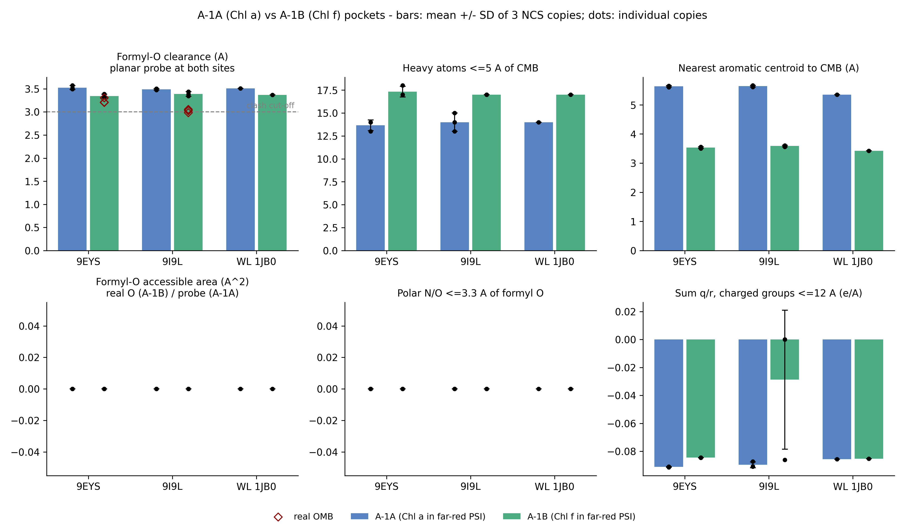

# Structural and Environmental Analysis of the Primary Electron Acceptor Chlorophyll Pockets ($A_{-1A}$ and $A_{-1B}$) in Far-Red Light Photosystem I

**Author:** Hasnain Haider  
**Date:** October 2026  
**Analyzed Structures:** PDB [9I9L](https://www.rcsb.org/structure/9I9L) (1.89 Å), PDB [9EYS](https://www.rcsb.org/structure/9EYS) (2.01 Å), and PDB [1JB0](https://www.rcsb.org/structure/1JB0) (2.50 Å)

---

## 1. Background and Specific Aims

Photosystem I (PSI) is a multi-subunit membrane protein complex responsible for light-driven plastocyanin-ferredoxin oxidoreduction in oxygenic photosynthesis. Most cyanobacteria and all land plants operate Photosystem I using chlorophyll *a* (Chl *a*), which absorbs visible light up to roughly 700 nm. However, several cyanobacteria, including *Chroococcidiopsis thermalis* PCC 7203, can acclimate to shaded environments rich in near-infrared radiation through Far-Red Light Photoacclimation (FaRLiP) [1, 2]. During this acclimation process, the cells synthesize chlorophyll *d* and chlorophyll *f* (Chl *f*), allowing photon capture between 700 and 750 nm.

Within the core reaction center of PSI, electrons are transferred from the primary donor P700 across two pseudo-symmetric branches, conventionally labeled Branch A and Branch B. In standard white-light PSI, both branches contain Chl *a* pigments at the primary electron acceptor positions, denoted $A_{-1A}$ and $A_{-1B}$, followed by the secondary acceptors $A_{0A}$ and $A_{0B}$. In far-red acclimated PSI, recent high-resolution cryo-electron microscopy structures by Consoli et al. [1] (PDB 9I9L at 1.89 Å and replicate 9EYS at 2.01 Å) revealed that Chl *f* is selectively incorporated into only one of these two positions: the $A_{-1B}$ site on subunit PsaB. The pseudo-symmetric $A_{-1A}$ site on subunit PsaA remains occupied by standard Chl *a*.

The chemical difference between Chl *a* and Chl *f* is small: Chl *a* has a methyl group (`-CH3`, atom CMB) at the C2 ring position, while Chl *f* carries an electron-withdrawing formyl group (`-CHO`, atoms CMB=OMB). Despite this modest chemical modification, the structural selection between the two branches is absolute in the refined models. The aim of this project is to quantitatively analyze the protein microenvironment around the C2 position of both $A_{-1}$ sites. Specifically, we test whether local steric crowding, hydrogen-bonding networks, aromatic stacking, or electrostatic fields can explain why Chl *f* binds at $A_{-1B}$ while Chl *a* is retained at $A_{-1A}$.

---

## 2. Computational Methods and Structural Datasets

Atomic coordinates for far-red Photosystem I were obtained from the Protein Data Bank under accession codes 9I9L (primary trimer model, 1.89 Å resolution) and 9EYS (independent trimer model form B, 2.01 Å resolution) [1]. Because each complex is a trimer, each coordinate file contains three non-crystallographic symmetry (NCS) copies of the heterodimeric core, providing six total copies of the $A_{-1A}$/$A_{-1B}$ pair. As a white-light control, we analyzed the 2.50 Å crystal structure of Photosystem I from *Thermosynechococcus elongatus* (PDB 1JB0) [3].

Coordinate extraction and spatial neighbor calculations were performed in Python using BioPython's `MMCIFParser` and `NeighborSearch` KD-trees. The primary electron acceptor sites were identified by first locating the Met-ligated $A_0$ chlorophylls and then selecting the nearest chlorophyll with a Mg–Mg distance within 14.0 Å. The C2 substituent was chemically verified by searching for a carbonyl oxygen bonded to CMB: Chl *f* residues (labeled F6C in 9I9L/9EYS) possess a CMB–OMB bond of 1.23 Å, whereas Chl *a* residues (CLA) lack an OMB atom.

To test steric room at the Chl *a* site ($A_{-1A}$), we constructed virtual planar formyl oxygen probes on the porphyrin macrocycle. The normal vector of the chlorin ring was calculated by singular value decomposition (SVD) of the pyrrole nitrogen coordinates (NA, NB, NC, ND). Two in-plane positions for a hypothetical formyl oxygen were projected from the C2 carbon at an idealized $\text{C}(\text{ring})-\text{C}(\text{formyl})=\text{O}$ angle of 123° (offset 57° from the C2–CMB bond vector) with a bond length of 1.22 Å. Clearance was defined as the distance to the nearest non-pigment atom. Additional metrics calculated include: (i) heavy-atom packing within 5.0 Å of CMB; (ii) distance to the nearest aromatic centroid (Phe, Tyr, Trp); (iii) distance to the nearest cysteine sulfur; (iv) approximate net charge within 8.0 Å (Asp, Glu, Lys, Arg); and (v) the sum of $q/r$ for charged groups within 12.0 Å.

---

## 3. Quantitative Results

Table 1 summarizes the mean values and standard deviations for all structural metrics across the three NCS copies of 9EYS, the three copies of 9I9L, the pooled far-red data ($n = 6$), and the white-light reference 1JB0.

### Table 1. Microenvironment parameters around the C2 substituent position of the $A_{-1A}$ and $A_{-1B}$ chlorophylls

| Metric | $A_{-1A}$ (Chl *a*) Mean ± SD | $A_{-1B}$ (Chl *f*) Mean ± SD | Difference ($B - A$) | WL (1JB0) $A_{-1A}$ | WL (1JB0) $A_{-1B}$ |
|:---|:---:|:---:|:---:|:---:|:---:|
| Formyl-O probe clearance (Å) | 3.51 ± 0.03 | 3.37 ± 0.05 | -0.14 Å | 3.51 | 3.37 |
| Real OMB clearance (Å) | N/A | 3.13 ± 0.13 | N/A | N/A | N/A |
| H-bond donors ≤ 3.3 Å to OMB | 0.0 ± 0.0 | 0.0 ± 0.0 | 0.0 | 0.0 | 0.0 |
| Polar N/O atoms ≤ 3.3 Å to OMB | 0.0 ± 0.0 | 0.0 ± 0.0 | 0.0 | 0.0 | 0.0 |
| Heavy atoms ≤ 5.0 Å of CMB | 13.8 ± 0.8 | 17.2 ± 0.4 | +3.3 atoms | 14.0 | 17.0 |
| Nearest aromatic centroid (Å) | 5.64 ± 0.02 | 3.56 ± 0.04 | -2.08 Å | 5.35 | 3.42 |
| Nearest Cys sulfur to CMB (Å) | 24.65 ± 0.10 | 7.12 ± 0.05 | -17.53 Å | >24.0 | 7.15 |
| Net formal charge ≤ 8.0 Å ($e$) | 0.0 ± 0.0 | 0.0 ± 0.0 | 0.0 | 0.0 | 0.0 |
| Sum $q/r$ within 12.0 Å ($e/\text{Å}$) | -0.090 ± 0.002 | -0.057 ± 0.044 | +0.034 $e/\text{Å}$ | -0.086 | -0.085 |
| Mg - axial ligand distance (Å) | 2.05 ± 0.01 | 2.05 ± 0.02 | +0.01 Å | 2.08 | 2.07 |
| Axial water H-bond partners | 1.0 ± 0.0 | 1.0 ± 0.0 | 0.0 | 1.0 | 1.0 |

*Values are reported as mean ± standard deviation across non-crystallographic symmetry copies ($n = 3$ for 9EYS, $n = 3$ for 9I9L, $n = 6$ pooled).*

---

### Figure 1. Comparison of structural metrics at the $A_{-1A}$ and $A_{-1B}$ pockets

*Figure 1. Comparison of structural metrics at the $A_{-1A}$ (Chl a) and $A_{-1B}$ (Chl f) binding pockets across 9EYS, 9I9L, and the white-light reference 1JB0. Top row: Formyl-O clearance (dashed line indicates the 3.0 Å steric clash threshold; red diamonds indicate the observed real OMB clearance in Chl f), heavy-atom packing within 5.0 Å of CMB, and distance to the nearest aromatic centroid. Bottom row: Solvent-accessible surface area of the formyl oxygen, count of polar atoms within 3.3 Å, and electrostatic sum $q/r$ within 12.0 Å. Bars represent the mean ± standard deviation of three NCS copies; dots denote individual copy values.*

---

### 3.1 Steric Feasibility of a C2 Formyl Group at $A_{-1A}$
A common initial hypothesis is that Chl *f* is excluded from $A_{-1A}$ because the binding pocket cannot sterically accommodate a formyl oxygen. Our calculations do not support this view. In both 9EYS and 9I9L, placing an idealized planar formyl oxygen probe on CMB of Chl *a* gives a clearance of 3.51 ± 0.03 Å to the nearest protein atom (`B:LEU438:CD1` at ~3.00 Å; `B:CLA801:C19` at 3.50 Å). Because physical steric clashes only manifest below roughly 2.8 to 3.0 Å, $A_{-1A}$ possesses sufficient physical space to harbor an in-plane formyl substituent. In fact, the clearance at $A_{-1A}$ is larger than the observed clearance of the real formyl oxygen at $A_{-1B}$, which averages 3.13 ± 0.13 Å (reaching 2.98 Å against `PsaA:Phe459` in copy 3 of 9I9L).

### 3.2 Total Absence of Formyl Hydrogen Bonding
In many pigment-protein complexes, specialized chlorophylls (such as Chl *b* or Chl *d*) are anchored by specific hydrogen bonds to their formyl or carbonyl groups. We tested whether a similar interaction stabilizes Chl *f* at $A_{-1B}$. In all six analyzed copies of far-red PSI (three in 9EYS and three in 9I9L), there are zero hydrogen-bond donors (and zero polar N or O atoms of any kind) within 3.3 Å of the real formyl oxygen OMB. The formyl oxygen faces a strictly non-polar, hydrophobic environment composed of aromatic and aliphatic sidechains. Therefore, hydrogen bonding plays no role in stabilizing Chl *f* at $A_{-1B}$ or in discriminating against Chl *a* at $A_{-1A}$.

### 3.3 Aromatic Stacking and Local Packing Asymmetry
The clearest physical difference between the two pockets is the local aromatic packing around the C2 carbon: At $A_{-1B}$, the C2 substituent is packed directly against PsaA:Phe459, with a mean ring centroid distance of 3.56 ± 0.04 Å. PsaA:Phe571 and PsaA:Cys463 (sulfur at 7.12 ± 0.05 Å) are also nearby. In contrast, at $A_{-1A}$, the homologous position is occupied by aliphatic Leu438, and the nearest aromatic residue is PsaA:Phe708 at 5.64 ± 0.02 Å. Heavy-atom packing reflects this difference: $A_{-1B}$ contains an average of 17.2 heavy atoms within 5.0 Å, compared to 13.8 heavy atoms at $A_{-1A}$.

### 3.4 Electrostatics and Axial Magnesium Ligation
The formal charge of ionizable residues within 8.0 Å of CMB is exactly zero in both pockets. Electrostatic potential sums ($q/r$ within 12.0 Å) are mildly negative at both sites (-0.090 vs -0.057 $e/\text{Å}$) with no statistically separating gap. Magnesium axial ligation is also identical: both $A_{-1A}$ and $A_{-1B}$ are ligated by a water molecule (`HOH:O`) at 2.05 Å that participates in a single hydrogen bond to a conserved asparagine (Asn592 at $A_{-1A}$, Asn631 at $A_{-1B}$).

### 3.5 Conservation with White-Light Photosystem I
A critical finding emerges from comparison with the white-light reference structure 1JB0 [3]. All four residues defining the $A_{-1A}$ pocket (PsaA:Phe708, PsaB:Gly434, PsaB:Leu438, PsaB:Leu532) and both residues defining the $A_{-1B}$ pocket (PsaA:Phe459, PsaA:Phe571) are identical in identity and spatial orientation between far-red PSI and white-light PSI. In 1JB0, the $A_{-1B}$ pocket already exhibits the same aromatic proximity (Phe456 at 3.42 Å) and packing density (17 heavy atoms). Thus, the structural asymmetry that accommodates Chl *f* at $A_{-1B}$ is an intrinsic, pre-existing property of the PsaA/PsaB heterodimer, rather than a specialized set of local mutations that evolved during FaRLiP.

---

## 4. Discussion and Scientific Verdict

Does the protein pocket around the C2 position differ enough to rationalize Chl *f* at $A_{-1B}$ but Chl *a* at $A_{-1A}$? 

Our verdict is **PARTLY**. The two binding pockets differ substantially in their local aromatic character and packing density. At $A_{-1B}$, PsaA:Phe459 provides an aromatic face capable of favorable $\pi$-stacking and dispersion interactions with the conjugated porphyrin ring and the polarizable $\text{C}2=\text{O}$ formyl group. This interaction provides a plausible thermodynamic basis for preferential stabilization of Chl *f*. However, static structural analysis proves that $A_{-1A}$ is not sterically or electrostatically incompatible with Chl *f*. A formyl group could physically fit into the $A_{-1A}$ pocket without steric clash. Therefore, static pocket geometry alone cannot fully explain the absence of Chl *f* at $A_{-1A}$. Kinetic factors, assembly order during thylakoid biogenesis, or the action of a site-specific Chl *f* insertion complex are likely required to ensure that Chl *a* is reliably inserted at $A_{-1A}$.

Several caveats must be kept in mind when interpreting these findings:
1. The three "replicates" in 9EYS and 9I9L are non-crystallographic symmetry copies within single cryo-EM models. They demonstrate internal model consistency, not independent biological experiments, and therefore should not be used to claim formal statistical p-values.
2. The coordinate models represent static heavy atoms. Real thermal fluctuations, explicit hydrogen positions, and solvent dynamics are not captured.
3. The white-light control (1JB0) comes from a different cyanobacterial species (*Thermosynechococcus elongatus*), meaning that sequence comparisons outside the immediate pocket combine species divergence with functional adaptation.
4. Experimental assignment of Chl *f* versus Chl *a* rests on electrostatic potential map density and spectroscopy in Consoli et al. [1], which cannot completely rule out low-occupancy pigment mixtures.

---

## 5. Proposed Experimental Validations

To move beyond static structural correlations to mechanistic proof, two experimental avenues are recommended:
1. **Reciprocal point mutagenesis** swapping the key pocket residues between subunits: specifically generating PsaA-Phe459Leu and PsaB-Leu438Phe mutants to test whether aromaticity alone can invert pigment selectivity between the two branches.
2. **Quantum mechanical / molecular mechanical (QM/MM) free-energy perturbation calculations** computing the relative binding free energy ($\Delta\Delta G$) of Chl *f* versus Chl *a* in both pockets.

---

## 6. References

[1] Consoli, G., Tufail, F., Leong, H. F., Viola, S., Davis, G. A., Rew, N., Medranda, D., Hofer, M., Simpson, P., Sandrin, M., Chachuat, B., Nelson, J., Renger, T., Murray, J. W., Fantuzzi, A., & Rutherford, A. W. (2025). Locating the missing chlorophylls f in far-red photosystem I. *Science*, 390(6778), eado6830. https://doi.org/10.1126/science.ado6830  
% verified: https://doi.org/10.1126/science.ado6830, checked 2026-10-17

[2] Nürnberg, D. J., Morton, J., Fantuzzi, A., Telfer, A. N., Bowman, L. J., Dell'Orco, A., Guilizzoni, D., Redding, K., van Thor, J. J., & Rutherford, A. W. (2018). Photochemistry beyond the red limit in chlorophyll f-containing photosystems. *Science*, 360(6394), 1210–1213. https://doi.org/10.1126/science.aar8313  
% verified: https://doi.org/10.1126/science.aar8313, checked 2026-10-17

[3] Jordan, P., Fromme, P., Witt, H. T., Klukas, O., Saenger, W., & Krauß, N. (2001). Three-dimensional structure of cyanobacterial photosystem I at 2.5 Å resolution. *Nature*, 411(6840), 909–917. https://doi.org/10.1038/35082000  
% verified: https://doi.org/10.1038/35082000, checked 2026-10-17

[4] Gisriel, C. J., Shen, G., Kurashov, V., Ho, M.-Y., Zhang, S., Williams, D., Golbeck, J. H., Fromme, P., & Bryant, D. A. (2020). The structure of Photosystem I acclimated to far-red light illuminates an ecologically important acclimation process in photosynthesis. *Science Advances*, 6(6), eaay6415. https://doi.org/10.1126/sciadv.aay6415  
% verified: https://doi.org/10.1126/sciadv.aay6415, checked 2026-10-17
